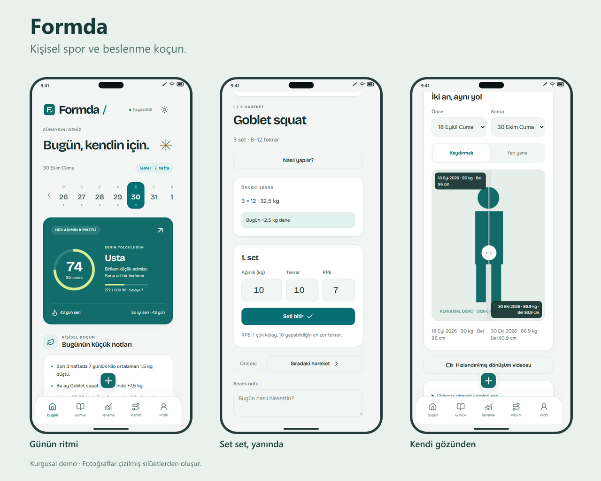
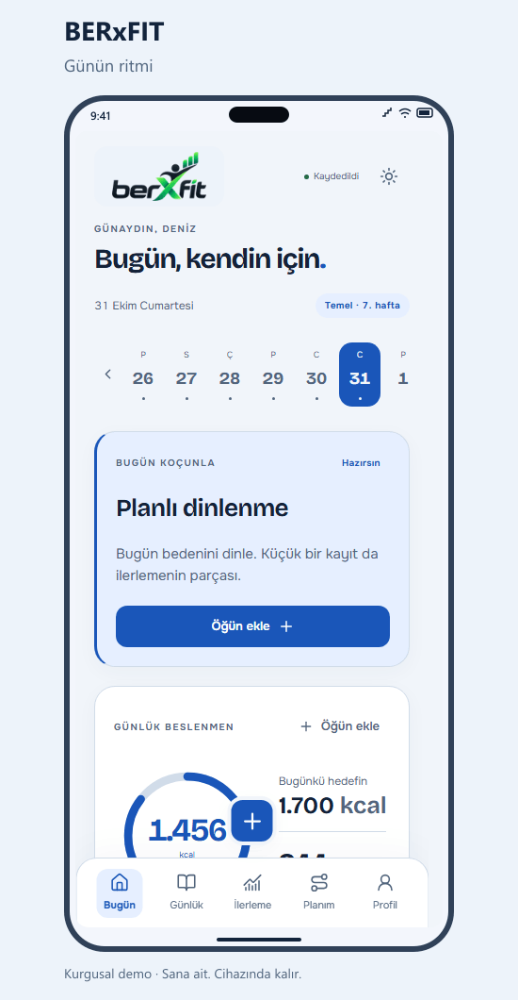
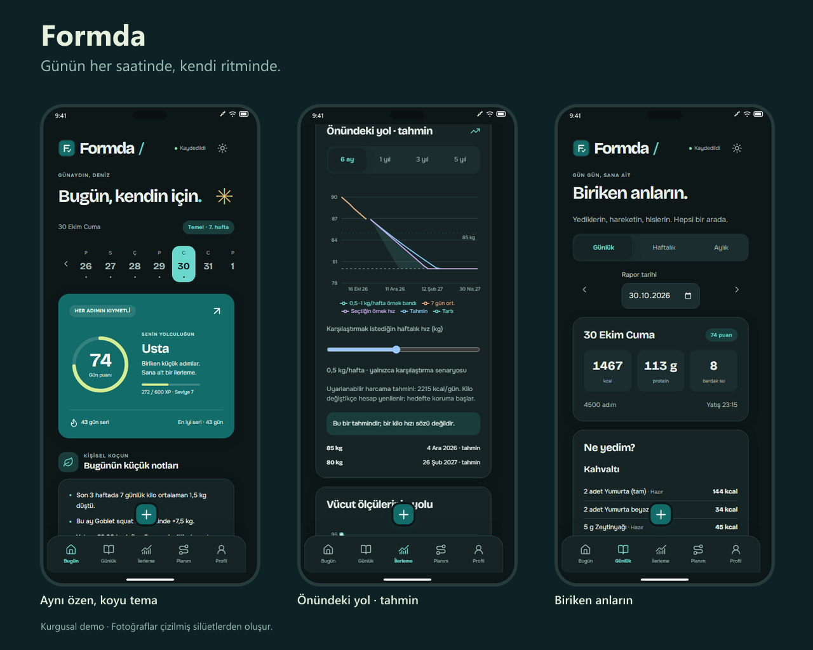
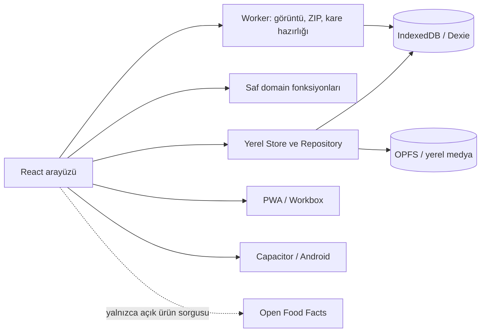

<p align="center"></p>
<h1 align="center">Formda</h1>
<p align="center"><strong>Kişisel spor ve beslenme koçun.</strong><br>Cebindeki kişisel spor ve beslenme asistanı.</p>
<p align="center">
  <a href="https://beratergun.github.io/formda/"></a>
  <a href="https://github.com/beratergun/formda/releases/download/v1.0.0/Yol-v1.0.0.apk"></a>
</p>
<p align="center">
  <a href="https://github.com/beratergun/formda/actions/workflows/deploy.yml"></a>
  <a href="https://github.com/beratergun/formda/actions/workflows/android.yml"></a>
  <a href="LICENSE"></a>
  
  
</p>
<p align="center"><a href="#english">English</a> · <a href="https://beratergun.github.io/formda/">Uygulamayı aç</a> · <a href="https://github.com/beratergun/formda/releases/tag/v1.0.0">v1.0.0</a></p>



<p align="center"></p>

**Formda**, ne yediğini, nasıl hareket ettiğini ve gününün nasıl geçtiğini aynı yerde tutan, telefona kurulabilen bir uygulama. PWA olarak Android ve iPhone'da; aynı React kodunun Capacitor paketiyle Android APK olarak çalışır. Hesap açmanı veya abonelik başlatmanı istemez.

Ekran görüntülerindeki Deniz, günlükler ve ölçüler tamamen **kurgusaldır**. Fotoğraflar çizilmiş silüetlerden oluşur. Gerçek kişi fotoğrafı, videosu veya sağlık kaydı bu repoda bulunmaz.

## Telefona kur

- **Android PWA:** uygulamayı Chrome'da aç, ilk açılıştaki **Uygulamayı yükle** kartına dokun. Kurulum olayı desteklenmiyorsa tarayıcı menüsünden ana ekrana ekle.
- **iPhone:** Safari'de aç → **Paylaş** → **Ana Ekrana Ekle**. Uygulamadaki görsel rehber adımları gösterir.
- **Android APK:** üstteki düğmeden APK'yı indir ve cihazının kurulum istemini izle. GitHub Secrets'ta release anahtarı yoksa indirilen dosya, Android geliştirme sertifikalı **debug APK**'dır. İmza doğrulaması ve SHA-256 dosyası release'te bulunur; Play Store paketi olarak sunulmaz.

Kurulduğunda ayrı bir uygulama penceresinde açılır: `standalone` görünüm, açılış ekranları, maskable ikonlar ve safe-area desteği vardır. İlk açılış için internet gerekir; varlıklar kaydedildikten sonra çevrimdışı açılır ve kayıt alır. Yeni sürüm, **Yeni sürüm hazır → Güncelle** kartıyla gelir.

GitHub Pages, uygulamanın statik dağıtım adresidir. PWA ve APK ayrı cihaz alanları kullanır; aralarında geçiş için tam ZIP yedeğini dışa aktar ve diğerinde geri yükle.

## Cebindeki yol arkadaşı

|                     | Yapabildiklerin                                                                                                                                                            |
| ------------------- | -------------------------------------------------------------------------------------------------------------------------------------------------------------------------- |
| 🥗 Beslenme         | 619 kaynaklı yiyecek; favori ve son kullanılanlar, Türkçe bulanık arama, yerel cümle ayrıştırma, porsiyon ve tarif hesabı, öğün fotoğrafı, dünden/plandan kopyalama        |
| ⚖️ Çiğ / pişmiş     | Ayrı yiyecek kayıtları ve açık durum rozeti; tavuk, pirinç, makarna ve mercimek için iki yönlü gramaj dönüşümü                                                             |
| 🏋️ Antrenman        | 84 hareketin adımları, hata ve güvenlik ipuçları, kas haritası, alternatifleri; set/kg/tekrar/RPE, önceki seans, dinlenme alarmı, ısınma/soğuma, hacim, rekor ve Epley 1RM |
| 🏊 Kendi ritmin     | Yüzme uzunluk ve aralık sayacı, kardiyo mesafesi/süresi; 6 ay, 1/3/5 yıl ve süresiz plan; 4 haftalık bloklar, hafif haftalar ve 12 haftalık değerlendirme                  |
| 📷 Fotoğraf takibi  | Ön/yan/arka poz, %30 hayalet hizalama, zamanlayıcı, galeriden ekleme, EXIF temizliği, önce/sonra kaydırıcısı, seçili fotoğraflarla yerel dönüşüm videosu                   |
| 🎞️ Vlog             | Kamerayla kayıt veya yükleme, gerçek kırpma, kapak karesi, başlık/ruh hâli/etiket; her gün bir saniyelik anı montajı                                                       |
| 📔 Günlük           | Günlük, haftalık ve aylık rapor; duygu ve hassasiyet haritası, not/etiket araması, fotoğraf karşılaştırması, PNG kartı ve PDF için yazdırma görünümü                       |
| ✳️ Yerel asistan    | Gerçek kayıtlardan trendler, kalan kalori/protein kombinasyonları, nazik hatırlatmalar, dönüm noktaları ve 153 özgün Türkçe söz                                            |
| 📈 İlerleme         | Puan/XP/seri, ısı haritası, kilo ve vücut ölçüleri, makrolar, antrenman ve alışkanlık grafikleri; hedefte duran, açıkça tahmin etiketli projeksiyon                        |
| 🔐 Verinin kontrolü | PIN uygulama kilidi, küçük resimleri gizleme, depolama yönetimi, tam ZIP yedeği, birleştir/üzerine yaz, CSV, ICS ve eski JSON aktarımı                                     |

Tahminler bir kilo hızı sözü değildir. Uygulama tıbbi tavsiye veya egzersiz kalorisi/telafi kotası üretmez.



## Neden yerel öncelikli?

Günlüklerin bir hesabın veya servis aboneliğinin arkasında kalmasın istedim. Yapılandırılmış kayıtlar cihazın **IndexedDB** alanında, fotoğraf ve videolar öncelikle **OPFS**'te saklanır. OPFS yoksa IndexedDB Blob; Blob yazımını reddeden motorlarda aynı baytları koruyan ikili uyumluluk kodlaması kullanılır.

Uygulama sunucusu, analitik, otomatik bulut eşitlemesi veya uzaktan fotoğraf tanıma yoktur. Tek isteğe bağlı dış sorgu, sen **Paketli ürün ara** dediğinde Open Food Facts'e gönderilen ürün adı/barkodudur. Günlük, fotoğraf veya profil bu isteğe eklenmez. Fontlar ve görseller uygulamayla birlikte paketlenir.

PIN bir uygulama kilididir; cihaz şifrelemesinin yerini almaz. Tarayıcı verisini temizlemek kayıtları da kaldırabilir. Tam yedeğini cihaz dışında güvenli bir yerde sen saklarsın. Kamera, mikrofon ve paylaşım tercihleri her zaman ilgili işlemi başlattığında devreye girer.

## Teknoloji ve mimari

React 18 · strict TypeScript · Vite 6 · Tailwind CSS 4 · React Router · Dexie · Zod · date-fns · Recharts · framer-motion · fflate · Workbox / vite-plugin-pwa · Capacitor 8.



Hesaplar React'ten bağımsız `src/domain/` altında. 5 yıllık plan depoya gün gün yazılmaz; yalnızca görünen tarih deterministik olarak hesaplanır. ZIP ve görüntü işlemleri worker kullanır. Tarayıcıdaki kayıt API'leri gerektiğinde DOM canvas ile akıtılır; destek yoksa tek dosyalık yerel slayt gösterisi üretilir.

[Mimari ve veri akışları](docs/architecture.md) · [Besin kaynakları](docs/food-sources.md) · [Android derleme ve imza](docs/android.md).

## Geliştir

Node.js **22.12+** ve npm gerekir. Android için JDK 21, Android SDK 36 ve Android Studio kullanabilirsin.

```sh
git clone https://github.com/beratergun/formda.git
cd formda
npm ci
npm run dev
```

Vite adresinin `/formda/` yolunu aç. Statik dağıtım için hash yönlendirme kullanılır.

```sh
npm run lint
npm run typecheck
npm run test
npm run test:coverage
npm run build
npx playwright install chromium webkit
npm run test:e2e
npm run preview
```

Android için aynı kaynak kodu paketle:

```sh
npm run android:sync
npm run android:open
```

`main` üzerindeki Actions iş akışları kaliteyi, Pages dağıtımını ve APK derlemesini yürütür. Dört imza sırrı varsa release APK; yoksa debug APK üretilir. Anahtar üretme ve Secrets ekleme adımları [Android rehberinde](docs/android.md).

## Test ve kalite

- **95 birim testi:** 40'tan fazla Türkçe ayrıştırma örneği, referans kalori hesapları, puan/seri, program, TDEE, projeksiyon, ilerleme, asistan, ICS, eski veri ve yedek bütünlüğü.
- **Domain kapsamı:** satır %100, fonksiyon %100, dal %98,14; ölçülen ifade kapsamı %99,6.
- **8 E2E testi:** Pixel 7 / Chromium ve iPhone 14 / WebKit boyutlarında kalıcı kayıt, çevrimdışı açılış, antrenman, fotoğraf ve tam yedek eşitliği. Sahte kamera ve çalışma anında üretilen vlog Chromium'da; Windows WebKit portunda galeri ve depolama uyumluluk yolu doğrulanır.
- **Erişilebilirlik:** açık/koyu temada 18 görünümde otomatik WCAG A/AA denetimi; klavye, odak ve telefon taşma kontrolleri.
- **Mobil Lighthouse:** yerel üretim ölçümleri **96–99 / 100 / 100** (performans / erişilebilirlik / en iyi uygulamalar). Eşikler 90 / 95 / 95. Sonuç cihaz ve ağ koşuluna göre değişir.

[Doğrulama kapsamı ve yeniden çalıştırma](docs/quality.md). Ekranları yenilemek için önizleme sunucusu açıkken `node scripts/capture-demo.mjs`, ardından `node scripts/presentation-assets.mjs` çalıştır. Bu akış ayrı oturumda yalnızca kurgusal demo üretir.

## Yol haritası

- İsteğe bağlı ve açık onaylı bulut eşitlemesi
- Health Connect / Apple Health aktarımı
- Saat uygulaması
- İsteğe bağlı fotoğraf tanıma eklentisi

Bu entegrasyonlar mevcut sürümde etkin değildir; yerel kullanım bunlara bağlı değildir.

Katkılar için [CONTRIBUTING](CONTRIBUTING.md), güvenlik için [SECURITY](SECURITY.md), sürümler için [CHANGELOG](CHANGELOG.md). **MIT** · [Seyid Berat Ergün](https://github.com/beratergun).

---

<a id="english"></a>

## English

**Formda is a personal fitness and nutrition app that stays on your device.** Install the PWA on Android or iPhone, or download the Android APK above. Both use the same React source. GitHub Pages distributes the static app; it does not receive your journal or media.

Track meals using local Turkish sentence parsing, search, recipes, portions and explicit raw/cooked food entries. Follow workouts set by set with weight, reps, RPE, rest alarms, previous sessions and progression suggestions. An 84-exercise library includes instructions, safety guidance, muscle maps and alternatives. Swimming and cardio have dedicated recording controls.

Progress photos support ghost alignment, before/after sliders and local montage export. Record or upload video journals, trim clips and assemble one-second memories. Daily, weekly and monthly reports bring together meals, training, energy, mood and notes. A local rule engine uses actual records for trends and suggestions. Plans cover six months through five years, with repeating maintenance cycles, deloads and assessments.

**No account, subscription, analytics or application backend.** Records live in IndexedDB; media prefers OPFS with local storage fallbacks. The only optional external query is a product name/barcode sent to Open Food Facts when you explicitly request a packaged-product search. Photos, videos and health records are not attached. The PIN is an application lock, not device encryption. Export a full ZIP backup before clearing app data or moving between the PWA and APK.

The downloadable APK is a development-certificate **debug build** when release-signing Secrets are absent. Signed release builds use a user-owned keystore configured through GitHub Secrets; see [Android instructions](docs/android.md). Physical-device camera permission and installation dialogs still depend on the operating system. Desktop WebKit tests are not presented as physical iPhone tests.

**Measured quality:** 95 unit tests; 100% domain line/function coverage and 98.14% branch coverage; eight mobile-browser E2E tests; two-theme automated accessibility checks; local mobile Lighthouse 96–99/100/100. The full backup round trip verifies structured records and binary media equality. Scores can vary by device and network.

Use Node 22.12+, run `npm ci` and `npm run dev`. Validation commands and native build commands are listed above. The interface is Turkish. All screenshots, measurements and silhouette images shown here are fictional demo content. Contributions are welcome under the [MIT license](LICENSE).
