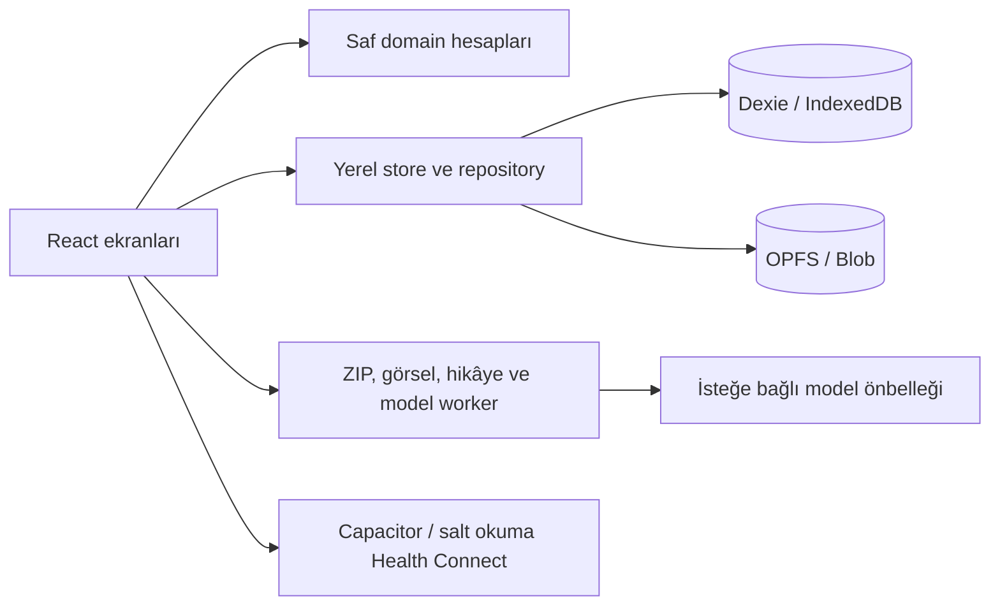

<p align="center"></p>
<h1 align="center">Formda</h1>
<p align="center"><strong>Kişisel spor ve beslenme koçun.</strong><br>Hesapsız, ücretsiz, cihazında.</p>
<p align="center">
<a href="https://beratergun.github.io/formda/"></a>
<a href="https://github.com/beratergun/formda/releases/download/v2.0.0/Formda-v2.0.0.apk"></a>
</p>
<p align="center">
<a href="https://github.com/beratergun/formda/actions/workflows/deploy.yml"></a>
<a href="https://github.com/beratergun/formda/actions/workflows/android.yml"></a>
<a href="LICENSE"></a>


</p>
<p align="center"><a href="#english">English</a> · <a href="https://github.com/beratergun/formda/releases/tag/v2.0.0">v2.0.0 ve SHA-256</a></p>


<p align="center"></p>

Formda, öğünlerini, antrenmanını ve günlüğünü aynı yerde tutan kişisel bir spor ve beslenme uygulaması. Android ve iPhone'da PWA olarak kurulabilir; Android APK arayüzü de cihazda paketler. Tüm ekranlar Türkçedir. Görsellerdeki Deniz, ölçüler, günlükler ve silüetler **tamamen kurgusaldır**.

## Telefona yükle

- **Android / PWA:** [Uygulamayı aç](https://beratergun.github.io/formda/) → Profil → Telefona yükle. Chrome menüsündeki “Uygulamayı yükle” seçeneği de kullanılabilir.
- **iPhone / PWA:** Safari → Paylaş → Ana Ekrana Ekle.
- **Android / APK:** [Formda-v2.0.0.apk](https://github.com/beratergun/formda/releases/download/v2.0.0/Formda-v2.0.0.apk), Android 8+. İndirme iznini Android sorar. Release Secrets yoksa APK geliştirme sertifikalı debug yapısıdır; mağaza imzalı paket olarak sunulmaz. [İmzalama rehberi](docs/android.md).

Eski web adresi yeni adrese yönlenir; aynı origin üzerindeki yerel veri adları korunur. **Eski Yol APK'sındaki veriyi Profil → Tam yedek ile alıp Formda'ya geri yükle.** Ayrı Android kimlikleri nedeniyle otomatik veri geçişi yoktur. Yedeği doğrulamadan eski kurulumu kaldırma. PWA ve APK arasında da tam ZIP yedeği kullanılır.

## Günlük koçun

| Alan      | Yapabileceklerin                                                                                                                                       |
| --------- | ------------------------------------------------------------------------------------------------------------------------------------------------------ |
| Bugün     | Günün planı ve tek eylemli koç kartı; kalori, protein, tahmini harcama ve adım halkaları; su, enerji ve kısa notlar                                    |
| Beslenme  | Türkçe yazarak ekleme, 797 kaynaklı yiyecek, 160 malzemeli örnek tarif, porsiyon/gram ve çiğ/pişmiş dönüşümü; açık Open Food Facts isim/barkod araması |
| Antrenman | 5 hazır program + kişisel plan; salon/ev/kısa gün alternatifleri; set, kg, tekrar, RPE, dinlenme, önceki seans ve ilerleme önerisi                     |
| Rehber    | 159 hareket, 34 alet, kas haritaları, başlangıç/bitiş vektör pozları, nefes, güvenlik ve programa ekleme                                               |
| İlerleme  | 6 ay–5 yıl planlama, hafif haftalar; grafikler, rekorlar, seri koruyucu, kilitli rozetler ve cihazda üretilen aylık hikâye kartları                    |
| Anılar    | Hayalet hizalama, karşılaştırma kaydırıcısı, fotoğraf zaman tüneli, vlog ve yerel montaj; günlük/haftalık/aylık raporlar                               |
| Veri      | PIN, tam ZIP yedek/geri yükleme, CSV, ICS, eski JSON aktarımı ve kurgusal demo modu                                                                    |

<p align="center"></p>

## Kaynağı açık hesaplar

619 eski besin kaydı resmi USDA SR Legacy dağıtımıyla denetlendi. Geçmiş öğünlerin kayıtlı kalorileri yeniden hesaplanmaz. Her güncel yiyecek kaynak kimliği ve hazırlama durumunu taşır. Karma yemeklerde malzemeler, bitmiş ağırlık ve porsiyonlar görülebilir; tarif ve markaya göre gerçek değer değişir. [Besin denetimi](docs/food-sources.md).

Harcanan enerji, Compendium MET değerleri ve set/RPE/süre ya da boy/kilo/adım hesabıyla **tahmin** edilir. Hedefe geri ekleme varsayılan kapalıdır; Profil'de kullanıcı kendi yüzdesini seçebilir. Bir kaynak günlük toplamı varsa seanslar tekrar eklenmez. Kalori yakma kotası veya telafi mesajı yoktur.

Android Health Connect, açık izinle **yalnızca** adım, aktif kalori, egzersiz, kilo ve uyku okur. Önizleme onaylanmadan kaydetmez, kaynaklara yazmaz. Health Connect yoksa veya izin reddedilirse elle kayıt sürer. PWA'da adım ve aktif kalori elle girilir; iPhone HealthKit bu sürümde yoktur.

Fotoğraftan yemek önerisi isteğe bağlıdır: Apache-2.0 Food101 modeli ilk açılışta yaklaşık 100 MB indirilir, cihazda önbelleğe alınır ve üç öneri verir. Fotoğraf gönderilmez; yiyecek ve porsiyon kullanıcı tarafından onaylanır. Model 101 sınıfla sınırlıdır, Türk yemeklerini karıştırabilir. 10 farklı doğrulama örneğinde 10/10 ilk üç isabet ve çevrimdışı yeniden açılış test edilmiştir; bu küçük örneklem genel doğruluk garantisi değildir. [Ölçüm kaydı](docs/model-evaluation.json).

## Gizlilik ve mimari

Sunucu, kullanıcı hesabı, abonelik veya analitik yok. GitHub Pages statik dosyaları dağıtır; günlük ve medya cihazda IndexedDB/OPFS ile saklanır. Ağ, uygulama dosyaları, kullanıcının açık ürün araması ve açık onaylı model indirmesi içindir. Fotoğraf, video ve sağlık verisi yüklenmez. Yedek paylaşımı yalnızca kullanıcının sistem paylaşım panelinden seçtiği hedefe yapılır.



React 18, strict TypeScript, Vite, Tailwind, Dexie, Workbox, Recharts, Zod, fflate ve Capacitor kullanılır. Ağır işlemler worker'a ayrılır; medya API'si desteklenmezse yerel uyumluluk yolu devreye girer. [Mimari](docs/architecture.md), [Android](docs/android.md), [varsayımlar](docs/assumptions.md), [üçüncü taraf lisansları](NOTICE.md).

## Geliştirme ve kalite

Node.js 22.12+ gerekir. Android için ayrıca JDK 21 ve SDK 36 kullanılır.

```sh
npm ci
npm run dev
npm run lint && npm run typecheck && npm run test && npm run build
npm run test:coverage
npx playwright install chromium webkit
npx playwright test
npm run android:sync
```

140 birim testi; Pixel 7/Chromium ve iPhone 14/WebKit boyutlarında 18 E2E; iki temada 26 WCAG görünümü. Eski/yeni yedek alanları ve medya baytları gidiş dönüşte karşılaştırılır. [Güncel kalite ölçümleri](docs/quality.md) ve [kabul matrisi](docs/acceptance-matrix.md) kapsamı ve fiziksel cihaz sınırlarını açıklar. Masaüstü WebKit sonucu fiziksel iPhone testi değildir.

## Yol haritası ve katkı

Fiziksel cihazlarla Health Connect kaynak uyumluluğunu genişletmek; iOS HealthKit dağıtımı ve gerekli Apple geliştirici hesabı; saat entegrasyonu; daha geniş Türk yemeği veri seti ve model değerlendirmesi. Güvenilir olmayan web hareket sensörü adım sayacı bu sürüme eklenmedi.

[Katkı rehberi](CONTRIBUTING.md) ve [güvenlik politikası](SECURITY.md). Uygulama kodu [MIT](LICENSE), Seyid Berat Ergün. Üçüncü taraf font, eklenti ve modeller kendi lisanslarını korur.

---

<a id="english"></a>

## English

**Formda is your personal fitness and nutrition coach, on your device.** Install the [PWA](https://beratergun.github.io/formda/) on Android or iPhone, or download the [Android APK](https://github.com/beratergun/formda/releases/download/v2.0.0/Formda-v2.0.0.apk) for Android 8+. The interface is Turkish. All demo records, measurements and silhouettes are fictional.

Choose five ready-made programs or keep your personal plan. Adapt a single day to a busy gym, home equipment or a short session. Track sets, weight, reps, RPE and rest, with previous-session guidance. Explore 159 exercises and 34 apparatus entries with original vector poses, muscle maps and safety instructions. Follow long-term plans, deload weeks, records, badges and shareable monthly stories.

Nutrition includes 797 sourced foods, 160 ingredient-based example recipes, Turkish sentence parsing, portions and raw/cooked conversion. The original 619 entries were audited against official USDA data. Historical meal snapshots remain unchanged. Calories burned are estimates and are not added to the daily goal by default.

Android Health Connect reads five categories with explicit permission and never writes back. Missing support or denied permission leaves manual tracking available. The PWA supports manual steps and active calories. Optional Apache-2.0 Food101 recognition downloads only after consent, runs locally, offers three suggestions, and requires food/portion confirmation. It covers 101 classes, not all Turkish cuisine. A ten-class, ten-image smoke evaluation achieved 10/10 top-three hits and offline worker reopening; this is not a population accuracy claim.

No account, subscription, analytics or personal-data server. IndexedDB stores records; OPFS stores media with Blob fallback. Explicit product search and model download are the only optional external services. Photos, videos and health records are never uploaded. Export full ZIP backups to move between devices or the PWA and APK. Before replacing the old Yol APK, export and verify its backup, then import it into Formda.

The APK uses a development certificate when release-signing Secrets are absent; see the [signing guide](docs/android.md). Automated desktop browsers cannot verify physical OS permission and installation panels. Use Node 22.12+, `npm ci`, `npm run dev`, and the validation commands above. The project includes 140 unit tests, 18 mobile-browser E2E cases and 26 two-theme accessibility views. See [quality evidence](docs/quality.md) for current results and limits.

Built with React, TypeScript, Vite, Dexie, Workbox, Capacitor and local workers. Contributions are welcome under the MIT license. Roadmap: broader physical-device Health Connect checks, iOS HealthKit distribution, wearables, and wider Turkish-food evaluation.
